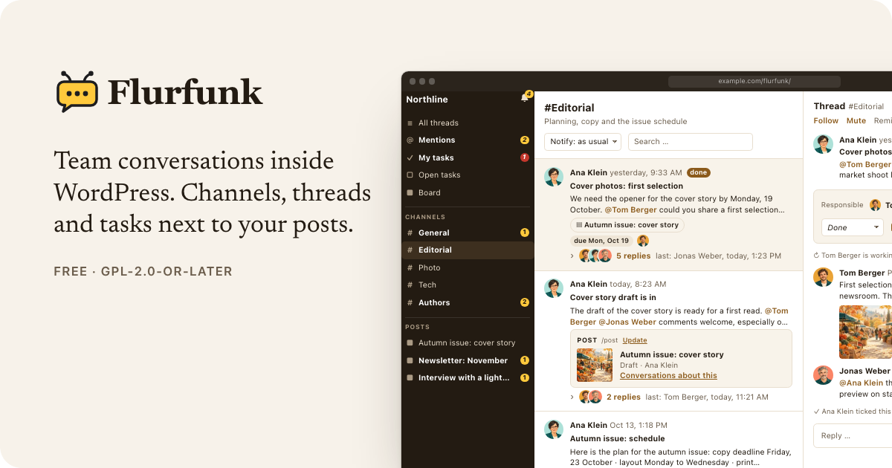

<p align="center">
  <a href="https://worldoptimizer.github.io/flurfunk/"></a>
</p>

<p align="center">
  <a href="https://worldoptimizer.github.io/flurfunk/"><b>Website</b></a> ·
  <a href="docs/installation.md"><b>Install</b></a> ·
  <a href="docs/user-guide.md"><b>User guide</b></a> ·
  <a href="docs/developers.md"><b>Developers</b></a> ·
  <a href="docs/examples.md"><b>Examples</b></a>
</p>

<p align="center">
  <a href="LICENSE"></a>
  
  
  
  <a href="https://github.com/worldoptimizer/flurfunk/releases/tag/v0.1.0"></a>
</p>

# Flurfunk

Team conversations inside WordPress. Channels, threads and tasks, attachable to posts, with
@mentions, files and cards from other plugins via slash commands. Works in plain wp-admin and
inside the OpenStation desktop.

- **Overview** (`wp-admin/admin.php?page=flurfunk`): sidebar with channels, mentions, open
  tasks and posts with conversations; thread list; thread pane. Your name sits at the bottom of
  the sidebar and opens your settings (light/dark, which mails you get, push, unread badge).
- **Full screen** (`/flurfunk/`): the same app without the admin bar and menu, installable as an
  app on a phone's home screen (see below).
- **Editor panel** "Conversations" for the configured post types.
- **Posts list column** with the number of conversations and open tasks.
- **Tasks** with states (open, in progress, question, done), due dates, responsible people,
  "My tasks", a board with drag and drop, and reminders.
- **Files** uploaded or picked from the media library, image galleries with a lightbox.
- **Notifications** in the app, by mail (instant or daily summary) and by Web Push, with quiet
  hours, pause, per-channel levels, follow, mute and "remind me".
- **Team and guests**: each channel decides what the team and what guests (e.g. guest authors)
  see.
- **Assistants** for agents and scripts, posting through WP-CLI or the REST API.
- **Embeds**: threads next to any element on an admin screen (e.g. a checklist).
- **Own tables**, one JSON format (`flurfunk/1`) for export and import with files, privacy
  export/erase.

Requires WordPress 6.5+, PHP 8.1+ and MySQL/MariaDB. Web Push needs HTTPS and PHP's OpenSSL
extension; no external service or library.

## Documentation

| | |
| --- | --- |
| [Overview](docs/index.md) | What Flurfunk does, feature tour |
| [Installation and administration](docs/installation.md) | Requirements, settings, access, assistants, cron, moving sites, privacy, uninstall, troubleshooting |
| [User guide](docs/user-guide.md) | Threads, formatting, mentions, slash commands, files, tasks, the board, notifications, shortcuts |
| [Developer guide](docs/developers.md) | Architecture, data format, REST API, providers, card blocks and actions, targets, embeds, hooks, WP-CLI |
| [Card gallery](docs/cards.md) | Every card building block, light and dark |
| [Examples](docs/examples.md) | A provider, a card renderer, a target type, embeds, shell and CI scripts, filters |

## Quick start

```bash
cd wp-content/plugins && git clone https://github.com/worldoptimizer/flurfunk.git flurfunk
wp plugin activate flurfunk
```

Then open *Settings → Flurfunk* (name, logo, colours, who is team or guest, channels) and
*Flurfunk* in the admin menu.

## Full screen and home screen app

`https://example.com/flurfunk/` shows Flurfunk on its own page: no theme, no admin bar, no admin
menu, the app fills the screen (also around notches). Logged-out visitors are sent to the login
and come back; logged-in people without access get a 403. "Open full screen" in your settings
(click your name) leads there, "Back to WordPress" returns. Without pretty permalinks the
address is `/?flurfunk_app=1`, which always works. Change the slug with the `flurfunk_app_slug`
filter; the rewrite rules are flushed once after activation, an update or a new slug.

The page carries a web app manifest (start and scope: that address, standalone display, name
and sidebar colour from the settings, the site icon or logo – or Flurfunk's own icon – at 192
and 512 px). To install it:

- **iPhone/iPad** (Safari): open the address, Share → *Add to Home Screen*. Open Flurfunk from
  the icon, then turn on push in your settings – iOS only delivers push to home screen apps,
  and that app has its own login.
- **Android** (Chrome): open the address, menu → *Install app* / *Add to Home screen*.

Once push was turned on in (or the app opened from) the home screen app, tapping a notification
opens the thread there instead of in wp-admin. Links to WordPress (e.g. "Open post") leave the
app's scope, so phones show them with a small browser bar on top of the app.

## Assistants (agents, scripts)

```bash
wp flurfunk bot-create --name="Assistant" --default   # account without editing rights
wp user application-password create <id> Agent --porcelain   # application password for the REST API
wp flurfunk post --channel=general --title="Report" --body="…" --file=report.csv
wp flurfunk post --ref=checklist:billing --card='flurfunk/post:{"id":12}'
```

```bash
curl -u "login:application password" -H 'Content-Type: application/json' \
  -d '{"channel":"general","title":"Deploy","body":"Release 2.4.0 is live."}' \
  https://example.com/wp-json/flurfunk/v1/threads
```

See [posting as an assistant](docs/developers.md#posting-as-an-assistant-from-scripts-and-ci).

## Data

```bash
wp flurfunk export backup.json
wp flurfunk export bundle/ --files     # with all files, for moving to another site
wp flurfunk import bundle/
wp flurfunk status
wp flurfunk channel news --name="News" --guests=own-posts
```

## Extending

A slash command with cards:

```php
add_action( 'init', function () {
	flurfunk_register_provider( 'myplugin/report', array(
		'command'  => 'report',
		'label'    => 'Report',
		'hint'     => 'Insert a report card',
		'search'   => fn ( string $q, int $user_id ) => array(
			array( 'ref' => array( 'id' => 12 ), 'title' => 'Q3', 'subtitle' => 'Draft' ),
		),
		'snapshot' => fn ( array $ref, int $user_id ) => array(
			'title'  => 'Q3',
			'metric' => array( 'value' => '1,284', 'label' => 'views' ),
			'spark'  => array( 3, 5, 2, 8 ),
			'url'    => admin_url( 'admin.php?page=reports' ),
		),
		'can'      => fn ( int $user_id ) => user_can( $user_id, 'edit_posts' ),
	) );
} );
```

Cards are built from ready blocks (`fields`, `checklist`, `progress`, `status`, `people`,
`table`, `badges`, `quote`) and can carry buttons that run PHP on the site (`actions`, with
inline confirmation and an event line in the thread); see
[card building blocks](docs/developers.md#card-building-blocks).

Also available: targets (`flurfunk_register_target`), channels from code
(`flurfunk_ensure_channel`), badges (`flurfunk_unread_count`), links (`flurfunk_url`), custom card
renderers (`Flurfunk.registerCard`), embeds (`Flurfunk.mountRefs`, `mountChannel`,
`mountTarget`) and filters and actions for access, notifications, mail and push. All of it is in
the [developer guide](docs/developers.md).

## Modules

Optional parts that only build on WordPress itself live in `modules/` and are switched on or off
under *Settings → Flurfunk → Modules* (or `wp flurfunk module on|off <id>`):

- **Comment cards** (`flurfunk/comments`, on): `/comment` inserts a comment with its state and
  buttons to approve it, mark it as spam or move it to the trash (people who may moderate).
- **Daily moderation thread** (`flurfunk/comments-daily`, off): once a day, if comments are
  waiting, a thread lists them, by default in its own channel #comments that requires
  `moderate_comments`.
- **Review requests** (`flurfunk/review`, off): a post submitted for review becomes a task for the
  people who may publish it; publishing ticks it off, back to draft marks it as a question.
  Settings: channel, and whether everyone who may publish is assigned.

Modules can bring settings of their own (channel, checkbox, number, text, select, roles), shown
under their switch and read with `flurfunk_module_setting()`. Channels can also require a
capability on top of their team and guest levels; see the [developer guide](docs/developers.md#channels-that-require-a-capability).

## Tests and development

- `wp eval-file tests/api-edge.php <team> <team2> <guest>`: 100+ checks on rights, input,
  mentions, read state, paging, editing, targets, mails, export/import. Cleans up after itself.
- `tests/e2e`: Playwright against a running site (`FF_BASE`, `FF_TEAM`, `FF_TEAM_PASS`,
  `FF_TEAM2`, `FF_TEAM2_PASS`, `FF_GUEST`, `FF_GUEST_PASS`, optional `FF_QUERY`).
- `tests/push/run.sh`: Web Push crypto checked against Node.
- `node tests/format.test.cjs`: the text formatter.
- `wp eval-file tests/load.php`: 2000 threads / 20000 messages, timings, cleans up.
- `wp eval-file tests/demo/seed.php`: demo content (a fictional editorial team with conversations,
  tasks and files) for screenshots and trying things out; see the developer guide.
- `tools/strings.py` collects the JavaScript strings into `inc/strings.php`; `tools/l10n.py`
  builds `languages/*.l10n.php` from `tools/translations/*.json`; `tools/build-zip.sh` builds a
  release zip.

License: GPL-2.0-or-later.
