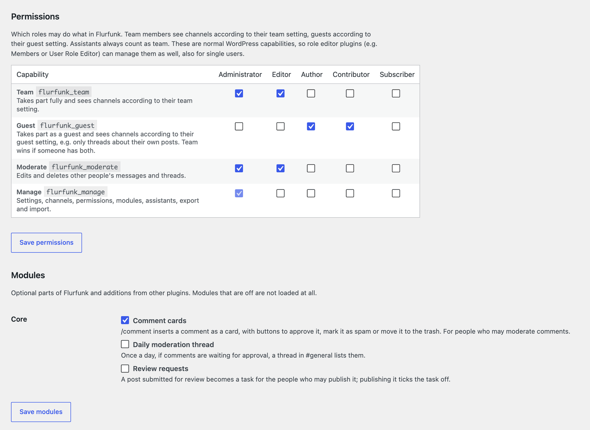

# Installation and administration

This page is for the people who set up and run Flurfunk on a site.

- [Requirements](#requirements)
- [Install](#install)
- [First steps](#first-steps)
- [Settings](#settings)
- [People and access](#people-and-access)
- [Assistants (agents and scripts)](#assistants-agents-and-scripts)
- [Cron: reminders, digests, cleanup](#cron-reminders-digests-cleanup)
- [Moving a site, backups](#moving-a-site-backups)
- [Privacy](#privacy)
- [Deactivate and uninstall](#deactivate-and-uninstall)
- [Troubleshooting](#troubleshooting)

## Requirements

| Requirement | Notes |
| --- | --- |
| WordPress 6.5 or newer | From the plugin header (`Requires at least: 6.5`). |
| PHP 8.1 or newer | From the plugin header (`Requires PHP: 8.1`). |
| MySQL or MariaDB | Flurfunk uses `GET_LOCK()` and `INSERT … ON DUPLICATE KEY UPDATE`. |
| HTTPS | Needed for Web Push and for application passwords (assistants). |
| PHP OpenSSL extension with EC support and `aes-128-gcm` | Needed for Web Push only. Without it, push is switched off and the app says so. Standard on most hosts. |
| Outbound HTTPS requests | The server sends push messages directly to the browsers' push services. |
| A working `wp_mail()` | For notification mails. Use an SMTP plugin if your host does not deliver mail reliably. |
| WP-CLI (optional) | For export/import, assistants and posting from scripts. |

No external service, library or API key is involved. Web Push (VAPID keys and encryption) is
implemented in PHP inside the plugin.

## Install

### From a zip

1. In wp-admin go to *Plugins → Add New → Upload Plugin* and upload the zip.
2. Activate **Flurfunk**.

To build a release zip from the repository, run `tools/build-zip.sh`. It needs `python3`,
`rsync` and `zip`, and writes `dist/flurfunk-<version>.zip` without tests, tools and docs.

### From GitHub

```bash
cd wp-content/plugins
git clone https://github.com/worldoptimizer/flurfunk.git flurfunk
wp plugin activate flurfunk
```

If you download the repository as a zip from GitHub instead, rename the extracted folder to
`flurfunk` before uploading it.

### Updates

Replace the plugin files (upload, `git pull`, rsync). The database tables are brought up to date
automatically on the next request, even without reactivating the plugin.

### What activation does

- creates the tables `{prefix}flurfunk_channels`, `_threads`, `_messages`, `_mentions`,
  `_reads`, `_attachments`, `_assignees`, `_notifications` and `_push`
- creates the channel `#general` ("Anything that concerns everyone"), visible to the team, not
  to guests
- schedules the cron jobs described [below](#cron-reminders-digests-cleanup)

## First steps

1. Open *Settings → Flurfunk*.
2. Under **Look**, set a name (default: the site title), a logo and the two colours.
3. Under **Permissions**, check which roles count as team and which as guest (the defaults:
   administrators and editors are team, authors and contributors guests).
4. Under **Channels**, rename `#general` if you like and add the channels you need. Set for each
   channel what the team sees and what guests see.
5. Under **Posts**, choose the post types conversations can be attached to.
6. Open *Flurfunk* in the admin menu and start the first thread.

Each person then sets their own notification preferences under their name at the bottom of the
Flurfunk sidebar. See the [user guide](user-guide.md#notifications).

## Settings

*Settings → Flurfunk* needs the `flurfunk_manage` capability (administrators, by default).

| Section | Setting | Default | Meaning |
| --- | --- | --- | --- |
| Look | Name | site title | Shown at the top of the sidebar, in mail subjects and as the web app name. |
| Look | Logo | none | Sidebar logo, push notification icon, fallback app icon. |
| Look | Accent colour | `#0f6e66` | Mentions, unread counts, links. |
| Look | Sidebar colour | `#1f2a2e` | Sidebar background and the web app theme colour. |
| Channels | Active, Name, Topic, Team sees, Guests see, Also requires, Order | | One row per channel, plus a row for a new channel. "Also requires": a capability people need on top of that to see the channel at all, see [Channel access](#channel-access). |
| Assistants | New assistant | | Creates an assistant account. Lists existing ones with a link to their application passwords. |
| Posts | Conversations about | `post` | Post types threads can be attached to and that get the editor panel and the list column. |
| Posts | Show | both on | The "Conversations" panel in the block editor, the column in the posts list. |
| Data | Keep conversations when the plugin is deleted | on | See [Deactivate and uninstall](#deactivate-and-uninstall). |
| Permissions | Roles × capabilities | see below | Which roles are team or guest, moderate and manage. Saved with its own button. See [Permissions](#permissions). |
| Modules | A switch per module, and its settings underneath | | Optional parts, e.g. the daily moderation thread (setting: its channel) and review requests (settings: channel, assign everyone who may publish). Saved with their own button. |

A new channel's short name (slug) is derived from its name and cannot be changed in the form
later. To choose the slug yourself, create the channel with WP-CLI:

```bash
wp flurfunk channel news --name="News" --topic="What goes out today" --team=all --guests=own-posts
```

Unticking **Active** archives a channel: nobody sees it any more, but its threads stay in the
database and in exports.

Developers can override settings in code with the `flurfunk_settings` filter, see the
[developer guide](developers.md#hooks).

## People and access

### Team and guests

Every user is one of:

| Kind | Who | Default |
| --- | --- | --- |
| team | has `flurfunk_team`, or is an assistant | editors and administrators |
| guest | has `flurfunk_guest` but not `flurfunk_team` | authors and contributors |
| none | everyone else | subscribers; they do not see Flurfunk at all |

A plugin can change this per user with the `flurfunk_user_kind` filter.

### Permissions

Flurfunk has its own capabilities, which WordPress grants through roles:

| Capability | Allows | Default roles |
| --- | --- | --- |
| `flurfunk_team` | take part as team | administrator, editor |
| `flurfunk_guest` | take part as a guest | author, contributor |
| `flurfunk_moderate` | edit and delete other people's messages and threads | administrator, editor |
| `flurfunk_manage` | the settings page: channels, permissions, modules, assistants, export and import | administrator |

Change them under *Settings → Flurfunk → Permissions*: one row per capability, one column per role.
Administrators always keep `flurfunk_manage`, and nobody can take it away from the last role that
has it or from their own role, so you cannot lock yourself out. Modules and other plugins may add
capabilities of their own (for example "Send newsletters"); they appear in the same table, with the
roles they recommend already ticked when they were switched on.



**Role editor plugins.** Because these are normal WordPress capabilities, plugins such as
[Members](https://wordpress.org/plugins/members/) or
[User Role Editor](https://wordpress.org/plugins/user-role-editor/) show and change them too, also
for single users or custom roles. Both ways change the same thing.

**Updating from 0.1.** 0.1 chose a "team capability" and a "guest capability" in the settings. On
the first request after the update Flurfunk converts them once: roles that had the team capability
get `flurfunk_team`, the other roles with the guest capability `flurfunk_guest`, and roles with
`manage_options` (administrators) `flurfunk_manage` and `flurfunk_moderate`. So everyone keeps the
access they had; editors can edit other people's messages only once you tick "Moderate" for them.

**Uninstall** removes the capabilities from all roles; a reinstall grants them again.

### Channel access

Each channel has one level for the team and one for guests:

| Level | Sees |
| --- | --- |
| `all` | every thread in the channel |
| `own-posts` | only threads attached to one of their own posts |
| `none` | nothing; the channel does not appear |

Typical setups:

- Internal channel: team `all`, guests `none`.
- Channel for talking with guest authors about their texts: team `all`, guests `own-posts`.
  Each guest only sees the threads about their own posts. The team sees a hint "… can read this"
  on threads guests can read.
- Channel for one job, e.g. comment moderation: set **Also requires** to `moderate_comments`.
  Only people who may moderate comments see it, its threads, numbers, notifications and search
  results; nobody else can be mentioned there. The daily moderation thread creates such a channel,
  #comments, when you switch it on.
- Private channel for a few people: use the `flurfunk_channel_level` filter
  ([example](examples.md#a-private-channel)).

**Also requires** works on top of the levels: whoever lacks the capability sees nothing of the
channel, team or guest. *Team* (`flurfunk_team`) closes a channel to guests whatever its guest
level. Assistants pass for Team and Guest; for any other capability only if their account has it,
but the site's own modules can always post there as the assistant.

"Own posts" are the posts the person is the author of. A plugin can add co-authored posts with
the `flurfunk_owned_post_ids` filter.

### What people may do

| Action | Who |
| --- | --- |
| Read a thread, reply | everyone who can see it |
| Start a thread | team and guests in `all` channels; in `own-posts` channels only about their own posts |
| Attach a thread to a post | team: any post of the configured types; guests: their own posts |
| Change a task's state, due date and responsible people | everyone who can see the thread |
| Edit or delete a message or thread | its author, and people with `flurfunk_moderate` |
| Upload files | people with `upload_files`, and assistants |
| Attach files from the media library | their own files and files they may edit; assistants (through the API) any file not attached to a private post |
| Add a Flurfunk file to the media library | people with `upload_files`; guests only their own files |
| Use a card command | team; guests only commands meant for them (like `/post`, their own posts) |
| Manage settings, channels, permissions and modules | people with `flurfunk_manage` |

Developers can adjust several of these with filters (`flurfunk_can_edit`, `flurfunk_can_resolve`,
`flurfunk_can_target`, `flurfunk_can_attach`).

## Assistants (agents and scripts)

An assistant is a normal WordPress user with the role *Subscriber* and a marker
(`flurfunk_bot` user meta). Assistants:

- take part like the team (they see channels according to the team setting)
- have no editing rights in WordPress
- are marked **Assistant** next to their name in conversations
- get no mail (their address ends in `.invalid`) and no unread badge
- may upload files through Flurfunk even without the `upload_files` capability

### Create an assistant

In *Settings → Flurfunk → Assistants*, enter a name under "New assistant" and save. Or use
WP-CLI:

```bash
wp flurfunk bot-create --name="Build bot" --login=build-bot --default
```

`--default` makes it the author for `wp flurfunk post` when no `--as` is given. The first
assistant ever created becomes the default automatically. Without options the account is called
"Assistant" (in the site's language) with the login `flurfunk-assistent`. Running the command again for an existing login
only marks that user as an assistant.

### Give it an application password

Agents and scripts outside the server authenticate with an
[application password](https://make.wordpress.org/core/2020/11/05/application-passwords-integration-guide/):

```bash
wp flurfunk bot-password 42 --name="GitHub Actions"
```

This prints the login, the password (shown once) and the API address. You can also create the
password on the assistant's profile page (*Users → Edit → Application Passwords*); the settings
page links there. WordPress only offers application passwords on HTTPS sites (or when the
environment type is `local`).

How to post with it is described in the
[developer guide](developers.md#posting-as-an-assistant-from-scripts-and-ci).

### AI assistants

With WordPress 7.0 or newer an assistant can answer with AI. Set up the provider (Anthropic, Google
or OpenAI) and its key under *Settings → Connectors* – on a live site preferably as a constant in
`wp-config.php` (e.g. `define( 'ANTHROPIC_API_KEY', '…' );`), because the screen stores keys in the
database. Then switch on the module **AI assistants** under *Settings → Flurfunk → Modules* and give
an assistant an AI profile in the section **AI assistants** below it: switch it on, give it a role in
a few words (shown next to its name, e.g. "proofreads, checks sources"), tick what it should be able
to do, the channels it takes part in, write a few lines of instructions, and set a monthly token
budget (WordPress itself has no spending limit). People then write `@Name` in a thread; the assistant
answers in that thread.

What an assistant can do is chosen as **packs**, each marked "reads" or "suggests":

| Pack | What it stands for |
| --- | --- |
| Proofreading | Reads the post the thread is about, not just the thread. |
| Looking things up | Flurfunk's reading tools: other conversations in its channels. |
| Tasks | May suggest new tasks and conversations (as cards a person confirms). |
| SEO and teasers | Titles, excerpts, descriptions – needs SEOPress or the WordPress plugin "AI". |
| Images | Alt texts for images without one – needs the plugin "AI" with alt texts on. |
| Tech | Reads the site's state and error log – needs abilities that offer this. |

A pack the site cannot offer is shown dashed with what it needs. The line under the packs sums up
what the assistant reads, what it suggests and that it changes nothing by itself. The single
abilities and the preferred model are behind **Single abilities and model …**; plugins can add packs
of their own (`flurfunk_ai_packs`).

What it reads goes to the AI provider: the thread it was mentioned in and, if its profile allows it,
the text of the post the thread is about (only if the person asking may read that post). With tools
(read-only abilities, chosen per assistant) it can look things up – with the rights of the person
asking and, in Flurfunk, only in its own channels. Mention that in your privacy policy (*Settings →
Privacy* suggests a text) and check whether you need a data processing agreement with the provider.
Guests can only ask an assistant if its profile allows it; who may ask at all is the capability
**Ask AI assistants** (`flurfunk_use_ai`, under *Permissions*).

If the WordPress plugin **AI** is active and has editorial guidelines, the assistants follow them
too; abilities it offers (when its features are switched on) appear as tools or proposals.

Switches for the whole site, at the top of the section: replace email addresses and phone numbers
before anything is sent (on by default), keep a log of the last 100 answers without content (who,
where, model, tokens, tools), and offer **Summarize** in threads – a private summary for the person
who asks, never posted.

For a help channel (e.g. #ask-ai) an assistant can answer every new thread there without being
mentioned; replies in it still need a mention.

Abilities that change something (e.g. starting a task, updating an SEO title) can be given to an
assistant as **proposals**: it never runs them itself, but puts a card under its answer, and a
person clicks **Run** – with their own rights – or **Dismiss**.

An answer only notifies the person who asked; long messages are folded with **Show more**, so
threads stay calm.

### Limits

New threads and messages are limited to 30 per minute and person (administrators are exempt).
A runaway script gets HTTP 429 "That was a lot at once". Developers can change the limit with
the `flurfunk_rate_limit` filter.

## Cron: reminders, digests, cleanup

Flurfunk schedules four WP-Cron events:

| Hook | Schedule | Job |
| --- | --- | --- |
| `flurfunk_remind` | every 5 minutes (`flurfunk_5min`) | Sends the "remind me" reminders people set on threads. |
| `flurfunk_due` | hourly, at about half a minute past the hour | Reminds responsible people of tasks that are not done and due today or overdue, once per day, at each person's chosen hour. |
| `flurfunk_digest` | hourly, same timing | Sends the daily summary mail to people who chose it, at their chosen hour. |
| `flurfunk_cleanup_files` | daily | Removes unused Flurfunk files older than 30 days and old notifications (read after 90 days, unread after 180). |

WP-Cron only runs when someone visits the site. On a quiet site this has two effects:

- Reminders arrive late, up to the next visit.
- If no request happens during a person's chosen hour, the hourly job runs in a later hour and
  skips that person for the day. Due reminders for that day are then missed (an overdue task is
  reminded again the next day), and the next digest covers two days.

For reliable timing, run WP-Cron from a real cron job every five minutes:

```php
// wp-config.php
define( 'DISABLE_WP_CRON', true );
```

```cron
*/5 * * * * cd /path/to/wordpress && wp cron event run --due-now --quiet
```

Without WP-CLI, request `wp-cron.php` instead:

```cron
*/5 * * * * curl -s https://example.com/wp-cron.php?doing_wp_cron > /dev/null
```

All times (the chosen hour, quiet hours, due dates) use the site's time zone from
*Settings → General*.

## Moving a site, backups

Flurfunk keeps everything in its own tables, a few options and user meta. A normal full database
backup or migration includes it. For moving conversations between different sites, use the JSON
export.

### Export and import

```bash
# Everything as one JSON file; files stay links to this site
wp flurfunk export backup.json

# A folder with flurfunk.json and files/, for moving to another site
wp flurfunk export bundle/ --files

# On the new site
wp flurfunk import bundle/        # or: wp flurfunk import backup.json
```

What the import does:

- Creates missing channels with their name, topic, access levels, order and archive state.
- Matches people by email address. Authors that do not exist on the new site appear as
  "Deleted user", mentions of them as `@?`.
- With a bundle folder, stores the files again as Flurfunk files on the new site (and adds them
  to the media library if they were there before). Without a folder, files remain links to the
  old site.
- Skips threads it imported before, so running it twice is safe.
- Marks everything imported as read for everyone, so nobody gets a wall of "new".

What is not carried over: follow and mute settings, reminders, the notification list, push
subscriptions and personal preferences. The task history lines in a thread ("… set the due date
to …") are not imported either; due dates, responsible people and status are.

Run the import as an administrator (`wp flurfunk import bundle/ --user=admin`). Without `--user`,
the command picks the first administrator, because imported files need an owner.

The export contains names and email addresses of everyone who wrote something. Treat it as
personal data.

## Privacy

Flurfunk registers with WordPress's privacy tools (*Tools → Export Personal Data* and
*Tools → Erase Personal Data*) under the name "Flurfunk conversations".

| Tool | Effect |
| --- | --- |
| Export | All threads and messages the person wrote, with thread ID, title, text and date. |
| Erase | Their messages are replaced by a "deleted" note. Their threads keep the title, the text becomes "(removed on request)", and they no longer appear as author. Their read state, mentions, task assignments, notifications, push subscriptions and preferences are removed. |
| Deleting a user | If their posts are given to another user, their Flurfunk threads and messages go to that user too. Otherwise they stay and show as "Deleted user". Personal data (read state, mentions, assignments, notifications, push subscriptions, preferences) is removed either way. |

Erasing keeps conversations readable for everyone else.

## Deactivate and uninstall

**Deactivating** removes the scheduled cron jobs. Data and settings stay.

**Deleting** the plugin in wp-admin always removes the cron jobs and the site's push keys (all
push subscriptions stop working; people turn push on again after a reinstall). What happens to
the data depends on *Settings → Flurfunk → Data*:

| "Keep conversations when the plugin is deleted" | Result |
| --- | --- |
| on (default) | Tables, settings and preferences stay. Reinstalling brings everything back. |
| off | All Flurfunk tables are dropped, Flurfunk files that were never added to the media library are deleted, the settings and the personal preferences of all users are removed. Files that were added to the media library stay. |

Export first if you might need the conversations later: `wp flurfunk export bundle/ --files`.

## Troubleshooting

### Push notifications

| Symptom | Check |
| --- | --- |
| "Push notifications are not available in this browser or on this server." | The site must run on HTTPS, PHP needs OpenSSL with EC support and `aes-128-gcm`, and the browser must support the Push API. |
| iPhone or iPad: no push option | On iOS and iPadOS, web push only works for web apps on the home screen (iOS 16.4 or newer). Open Flurfunk in Safari, choose *Share → Add to Home Screen*, open it from the home screen, log in, and turn push on in your settings there. |
| "Notifications are blocked in this browser." | The browser's site permission for notifications is set to block. Allow it in the browser's site settings. |
| The test says "Could not send" | The server could not reach the push service. Outbound HTTPS from the server must be allowed (for example to `fcm.googleapis.com`, `updates.push.services.mozilla.com`, `web.push.apple.com`). |
| Test works, real notifications do not arrive | Check the person's push level (mentions or everything), quiet hours and pause. Muted threads only notify on mentions and tasks. You never get notified about your own messages. |
| Push stopped after restoring the site or reinstalling the plugin | The site got new push keys, so old subscriptions are invalid. On the same address, opening Flurfunk once in that browser subscribes it again. After a move to a new address, each person turns push on again. |

A browser that keeps failing (5 errors in a row) or that the push service reports as gone is
removed from the person's devices automatically.

### Mail

Flurfunk sends mail through `wp_mail()`. If nothing arrives, test general WordPress mail first
(for example with an SMTP plugin's test tool). Each person chooses their mail level; "Never"
turns mail off. Assistants never get mail.

### Reminders or digests arrive late or not at all

See [Cron](#cron-reminders-digests-cleanup). On low-traffic sites use a real cron job.

### Someone cannot see a thread or a channel

- Check their kind (team, guest or none): their role needs `flurfunk_team` or `flurfunk_guest`
  under *Settings → Flurfunk → Permissions* (or in a role editor plugin).
- Check the channel's level for their kind. Inactive (archived) channels are hidden from
  everyone.
- In `own-posts` channels, the thread must be attached to a post they are the author of.

### Someone cannot be mentioned or assigned

Only people who can see the thread can be mentioned or made responsible. The list of people in
the app includes users with the `edit_posts` capability and assistants.

### "Your session has ended. Please log in again."

WordPress logged the person out, or the page was open longer than the security token lasts and
renewing it failed. Log in again; drafts are kept in the browser.

### "That was a lot at once. Please wait a minute."

The rate limit of 30 new threads and messages per minute and person was reached. See
[Limits](#limits).

### Uploads fail

The upload button only shows for people with the `upload_files` capability. The maximum file
size is WordPress's upload limit (`upload_max_filesize` and `post_max_size` in PHP). File types
are checked like any WordPress upload.

### Very long threads

The app loads the newest 300 messages of a thread and says how many earlier ones are not shown.
Developers can change this with the `flurfunk_thread_limit` filter. Exports always contain all
messages.
