# User guide

This page explains Flurfunk for the people who use it every day.

- [Getting around](#getting-around)
- [Threads and replies](#threads-and-replies)
- [Formatting](#formatting)
- [Mentions](#mentions)
- [Slash commands and cards](#slash-commands-and-cards)
- [Files](#files)
- [Tasks](#tasks)
- [The board](#the-board)
- [Conversations about posts](#conversations-about-posts)
- [Follow, mute, remind me](#follow-mute-remind-me)
- [Notifications](#notifications)
- [Your settings](#your-settings)
- [Keyboard shortcuts](#keyboard-shortcuts)
- [For guests](#for-guests)

## Getting around

Open **Flurfunk** in the admin menu. The number next to it counts your unread messages.

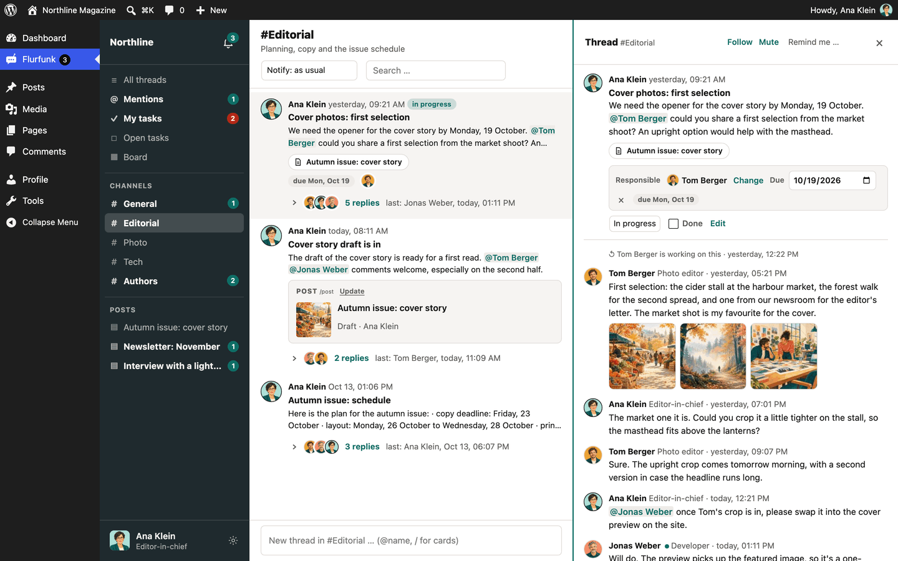

The overview has three columns:

1. **Sidebar** with the views, the channels, posts with recent conversations, the bell and your
   name at the bottom.
2. **Threads** of the current view, with a box for starting a new thread at the bottom. A
   channel reads top to bottom, as in Slack: the oldest thread first, the newest right above the
   box; the day sits on a line between days and stays at the top while you scroll through it; a
   thread keeps its place when someone replies (its "replies" line shows the news). If you scroll
   up, a **Latest** button brings you back down. All threads, a post's conversations and private
   conversations read the same way; mentions, tasks and search results are lists with the latest
   activity first.
3. **Thread pane** with the open thread and its replies.

| View | Shows |
| --- | --- |
| All threads | Everything you can see from every channel, in the order it was started, the newest at the bottom |
| A channel | Its threads in the order they were started, the newest at the bottom; older ones load at the top |
| Mentions | Threads where someone mentioned you |
| My tasks | Open tasks you are responsible for, by due date |
| Open tasks | All tasks not ticked off yet |
| Board | Tasks in columns by state: open, in progress, question, done |
| A post | All conversations about this post, from every channel |
| Bell | Your notifications |

Threads with unread messages are highlighted and show "… new". **Mark all as read** in the
header clears the unread state of the current channel; in the other views it clears everything.

The search box in the header searches thread titles, thread texts and replies.

Drag the edge of the sidebar or of the thread pane to change its width; double-click the edge
to reset it. Flurfunk remembers the widths in your browser.

Flurfunk updates itself every 30 seconds while it is visible, and right away when you come back
to the tab.

### Full screen

**Open full screen** in your settings (click your name) opens Flurfunk on a page of its own, at
`/flurfunk/` on your site: no admin bar, no admin menu, just the app. **Back to WordPress** returns.
On a phone the same address can be added to the home screen and then works like an app (see
[Push on phones and tablets](#push-on-phones-and-tablets)).

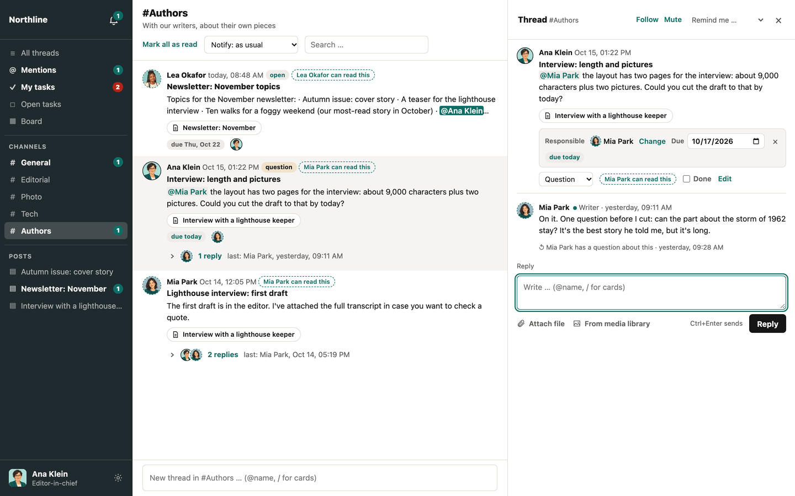

## Threads and replies

### Start a thread

Use the box at the bottom of the thread list:

1. Write the text. In a channel view the thread goes to that channel; elsewhere pick the
   channel from the list.
2. Optionally pick what the thread is about under **Attached to** (a post, or another type a
   plugin added). Search by typing.
3. Optionally tick **Task**, set a due date and click **Assign** to choose responsible people.
4. Press Enter or click the send button (the paper plane). Shift+Enter makes a new line.

### Reply

Click a thread to open it, write in the reply box at the bottom and press Enter or click the send button (Shift+Enter for a new line). If you scroll up in a long thread, a **Latest** button takes you back down; it counts the replies that came in meanwhile. The @ and / buttons under the box start a mention or a card, as typing the character does.

What you type is kept as a draft in this browser until you send it, even if you reload the page
or open another thread.

### Edit and delete

Point at one of your own messages: a small bar appears on its top edge with **Edit** (pencil) and
**Delete** (bin) – hold the pointer on an icon to see its name. On phones and tablets the icons
are always shown under the message. Administrators can edit and delete all messages. An edited
message is marked "(edited)". A deleted message leaves a short note ("… deleted a message") so
the replies after it keep their context. The text of the thread itself and its title are edited
the same way, from the bar on the first message.

## Reactions

Point at a thread or a reply and click the smiley in its bar (or the smiley next to existing
reactions): the picker shows the emoji you use most, then all of them by group, with a search
(English and German names). A reaction shows as a small capsule with a count; click a capsule to add
yours or take it back, point at it to see who reacted. Nobody is notified about reactions.

## Formatting

Flurfunk uses a small, Slack-like formatting. There is no toolbar; you type the marks.

| You type | You get |
| --- | --- |
| `*bold*` | **bold** |
| `_italic_` | *italic* |
| `~strike~` | ~~strike~~ |
| `` `code` `` | `code` |
| ```` ```code block``` ```` | a block of code (can span several lines) |
| `- item`, `* item` or `• item` at the start of a line | a bulleted list |
| `1. item` or `1) item` | a numbered list |
| `> text` | a quote |
| `https://…` | a link (opens in a new tab) |

Notes:

- Marks only work at word boundaries. `snake_case_name` and `3*4*5` stay as they are.
- Use single marks. `**text**` is not bold.
- Nothing inside code or links is formatted.
- Line breaks are kept.
- HTML is never interpreted; `<b>` shows as text.

## Mentions

Type `@` and the first letters of a name, then pick the person from the list. When you send,
`@Full Name` (or a first name that only one person has) becomes a mention.

The mentioned person is notified and the thread shows up in their **Mentions** view. Only people
who can see the thread can be mentioned. If you mention someone who has no access to the
channel or post, nothing reaches them.

Your own name is highlighted when someone mentions you.

## AI assistants

If your site has set up AI assistants, a channel's header says so ("1 AI assistant"); click it to see
what each assistant does there and what it reads. In the `@` list assistants are marked **AI** with
their role.

- **Ask:** mention the assistant in a thread, e.g. `@Proofreading Is the teaser clear?`. While it
  works, the thread shows what it is doing (reading the thread, looking things up, writing). The
  answer comes in the thread, and only you are notified.
- **What it was based on:** under each AI answer a line says what it read (the thread, the post it is
  about), which conversations it opened and which tools it used.
- **Suggestions:** an assistant never changes anything by itself. When it suggests something – a
  task, a new conversation, a reply – a card appears under its answer saying what would happen. A
  button runs it with your rights; **Dismiss** drops it. The card then says who did what.
- **Summarize:** in a thread's header, or offered when many messages are new to you – a short
  summary only you see (of just the new messages if you have read the rest). Nothing is posted.

- **Follow-ups:** right after its answer you can simply write on, without mentioning it again. If
  you only say thanks, it stays quiet. When someone else writes in between, mention it again.
- **Private conversations:** under **Assistants** in the sidebar each assistant you may ask has its
  own space. Write in the box at the bottom to start a conversation; it answers every message there
  without a mention. Only you see these conversations – not your team, not the site's
  administrators. Each conversation is separate: a new one starts fresh, the assistant does not
  remember the others.

- **Drafts:** if your administrators allow it, ask for one – "@Lektorat, make a short article of
  this thread, with the photo as featured image". It writes a draft with you as its author and
  puts a card with it under its answer; write on ("shorter title, please") and it changes the
  draft, until someone else has worked on it. It never publishes.
- **Rights:** an assistant works with your rights, never more, and never administers the site.
  Your administrators can limit it further (e.g. to what an author may); then it tells you when
  something may be outside its limit instead of claiming it does not exist.

What an assistant reads goes to the AI provider your site has chosen; your administrators decide
which assistants exist, where they take part and who may ask them.

## Slash commands and cards

Type `/` at the start of the text or after a space. A menu lists the commands you can use:

| Command | Inserts |
| --- | --- |
| `/post` | A post as a card: title, status, author, thumbnail, link to the editor |
| `/comment` | A comment with its state and buttons to approve it, mark it as spam or move it to the trash (if the module is on and you may moderate comments) |
| others | Whatever plugins on your site add |

Type the command, a space and a search term, for example `/post teaser`. Pick a result with the
mouse or the arrow keys. The card appears above the send button; click × to remove it again.
A message can carry up to 10 cards.

A card is a snapshot: it shows the data from the moment it was inserted, so it stays readable
even when the post or comment changes or is deleted. Click **Update** on a card to fetch the
current data.

Some cards have **buttons**, for example **Approve** on a comment. A button acts on the site right
away and the card shows the new state. Buttons that are hard to undo ask first, inside the card:
confirm, or press Esc or **Cancel** to leave it. The thread records who did what ("Ana approved
the comment"), and the people following the thread are notified as for a reply. You only see the
buttons you are allowed to use; if someone else was faster, the card says so and shows the
current state.

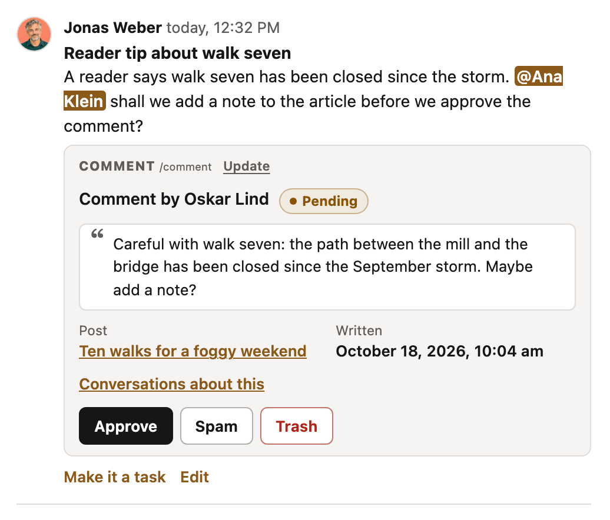

### Optional modules

Your administrator can switch on more under *Settings → Flurfunk → Modules*:

- **Comment cards** (on by default): the `/comment` command above.
- **Daily moderation thread**: once a day, if comments are waiting for approval, the assistant
  posts a thread with the number and a list of them, by default in its own channel #comments,
  which only people who may moderate comments see.
- **Review requests**: when a post is submitted for review, a task appears for the people who
  may publish it. Publishing it ticks the task off; moving it back to draft marks it as a
  question.

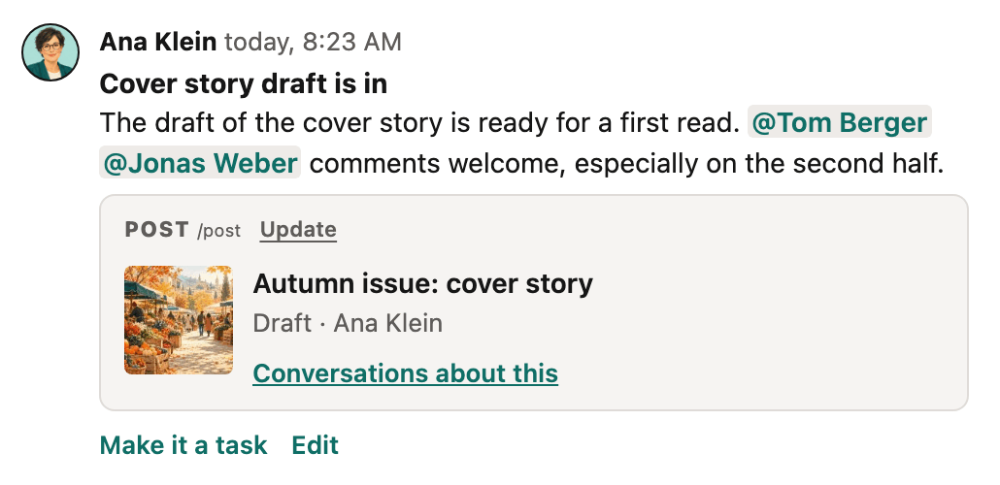

## Files

There are two ways to add files to a reply:

- **Attach file** (the paper clip under the box) uploads files from your computer. You can pick several at once. Wait until the
  upload has finished, then send.
- **From media library** (the picture icon) opens WordPress's media dialog. Pick one or more files that are already
  in the library. Nothing is copied: the message refers to the file where it is.

A message can carry up to 50 files. You can attach your own files and files you may edit.

How files show:

- One image shows as a preview, several as a gallery of thumbnails. Clicking an image opens it
  in a large view (lightbox): use the arrow keys or the ‹ › buttons to go through the images of
  the message, **Download** to save one, and Escape or a click next to the image to close it.
  Ctrl-click or Cmd-click opens the file in a new tab instead.
- Audio and video files show as players.
- Other files show as a download link with name and size. Long lists show the first six files;
  the rest fold away under "… more files".

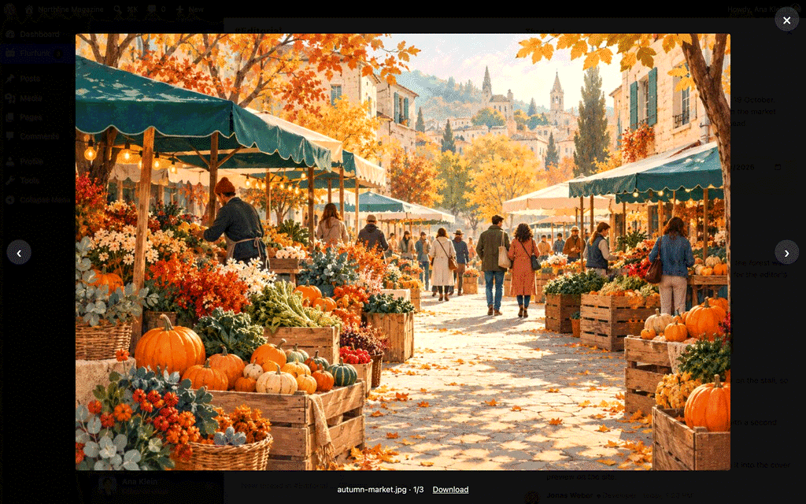

Files you upload in Flurfunk do not appear in the media library. If a file should be used
elsewhere, click **Add to media library** next to it. The file keeps its place and address, so
the message still works. Files nobody refers to any more are deleted after 30 days. A file
someone deleted from the media library shows as "no longer available".

You need the WordPress permission to upload files to see the **Attach file** and **From media
library** buttons.

## Tasks

Any thread can be a task.

- When starting a thread, tick **Task**.
- In an open thread, point at the first message and click **Make it a task** (the ticked box) in its bar.

A task has:

| Part | How |
| --- | --- |
| State | **Open**, **In progress**, **Question** or **Done**, chosen from the menu in the thread. Ticking **Done** closes the task, unticking reopens it. |
| Responsible | **Assign** (or **Change**) opens a list of people with a search box. Up to 20 people. |
| Due date | Pick a date; × removes it. |

Each change is noted in the thread, for example "Ada made Ben responsible" or "Ada set the due
date to Fri, 24 Oct".

The states:

| State | Use it when |
| --- | --- |
| Open | The task is waiting to be started. |
| In progress | Someone is working on it. |
| Question | It cannot go on without an answer. The person who started the task and the responsible people are notified. |
| Done | It is finished. |

**My tasks** lists your tasks that are not done (open, in progress or question) by due date
(tasks without a date last). Tasks due today are marked, overdue ones are red, and the sidebar
counts them. **Open tasks** lists all tasks that are not done.

Notifications about tasks:

- You get a notification when someone makes you responsible.
- On the due date, and every day after while the task is not done and overdue, you are reminded
  once a day at your chosen hour.
- When someone sets a task you started or are responsible for to **Question**, you are notified.
- When someone ticks off a task you started or are responsible for, you are notified.

## The board

**Board** in the sidebar shows the tasks you can see in four columns: Open, In progress,
Question and Done. Done shows the tasks finished in the last 14 days. Each card shows the title,
the channel, the due date, the number of replies and the responsible people.

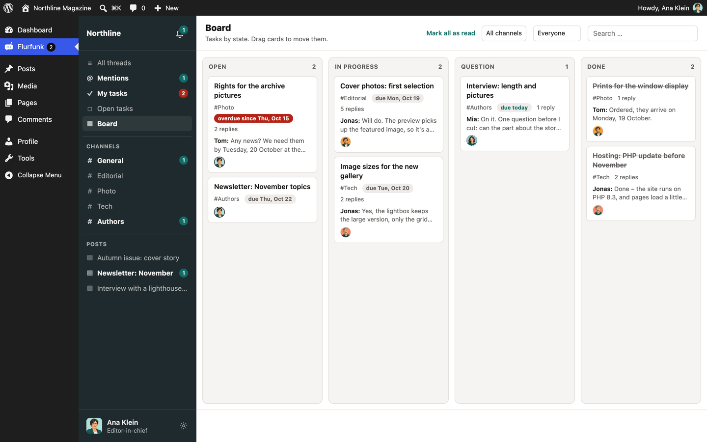

- Drag a card to another column to change its state.
- With the keyboard: focus a card and press Alt+Arrow right or Alt+Arrow left to move it one
  column on.
- Click a card (or press Enter) to open the thread next to the board.
- The two menus in the header filter by channel and by responsible person ("Me" for your own).

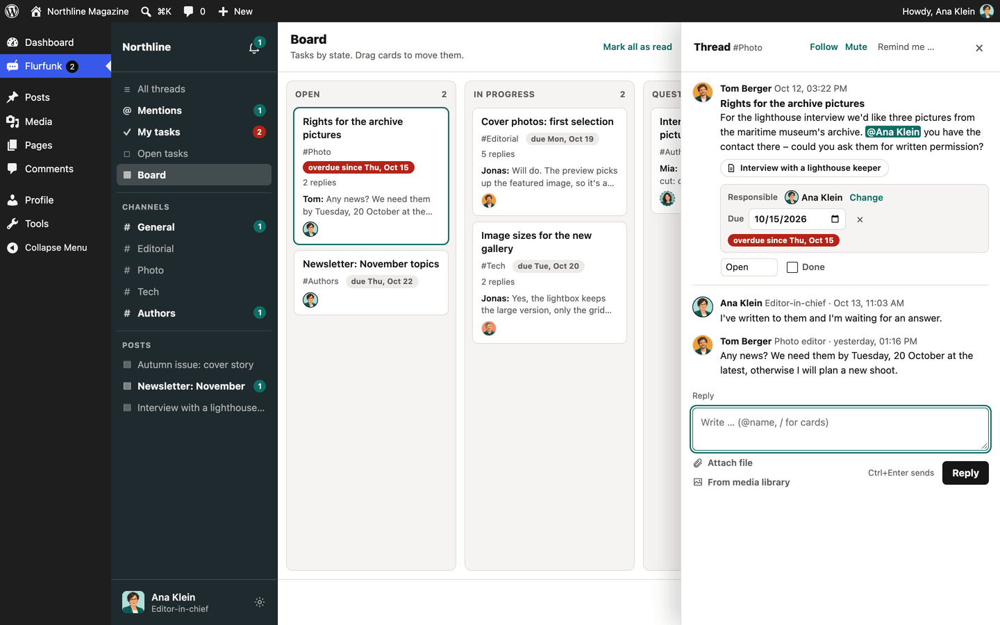

A move shows at once and is saved in the background. If saving fails, the card goes back.

## Conversations about posts

A thread attached to a post shows a small link with the post title. Clicking it shows all
conversations about that post, from every channel.

In the block editor, the **Conversations** panel in the document sidebar lists the threads about
the post you are editing. You can reply, tick tasks, set due dates and start a new conversation
right there (new conversations there are tasks unless you untick **Task**).

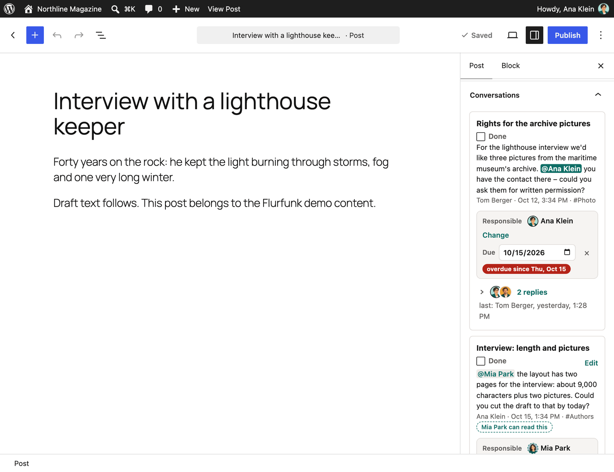

The posts list has a column with the number of conversations and open tasks per post; click it to
open them in Flurfunk.

Team members see a hint like "Guests can read this" or "Jane Doe can read this" on threads that
guests can read.

## Follow, mute, remind me

The header of an open thread has these icons (hold the pointer on one to see its name):

| Icon | Effect |
| --- | --- |
| Bell – **Follow** | You are notified about every reply, even if you never wrote in the thread. |
| Crossed-out bell – **Mute** | You are only notified when someone mentions you or gives you a task. |
| Clock – **Remind me …** | In an hour, tomorrow or next Monday (at your chosen hour). You get a "Reminder" notification for the thread. Choose **No reminder** to remove it. |
| Spark – **Summarize** | A short summary from an AI assistant, only for you (if the site has one in this channel). |

A highlighted bell means you follow or muted the thread; click it again to go back to normal. A reminder that falls into your
quiet hours or a pause waits until they end.

## Notifications

### What you are notified about

| Kind | When |
| --- | --- |
| Mention | Someone wrote `@you`. |
| Task | Someone made you responsible for a task. |
| Due | A task of yours is due today or overdue (once a day). |
| Reminder | The reminder you set on a thread. |
| Reply | A new message in a thread you started, wrote in, are responsible for, or follow. |
| Question | A task you started or are responsible for was set to "Question". |
| Done | A task you started or are responsible for was ticked off. |
| Channel | A new thread or reply in a channel you set to "every new post". |
| Message | Anything else you can see, only if you chose "everything" for mail or push. |

You are never notified about your own actions. In a muted thread only mentions and tasks get
through.

### The bell

Every notification lands in the list behind the bell at the top of the sidebar, whatever you
chose for mail and push. Opening a thread marks its notifications as read. **Mark all as read**
clears the list. Read notifications are removed after 90 days, unread ones after 180.

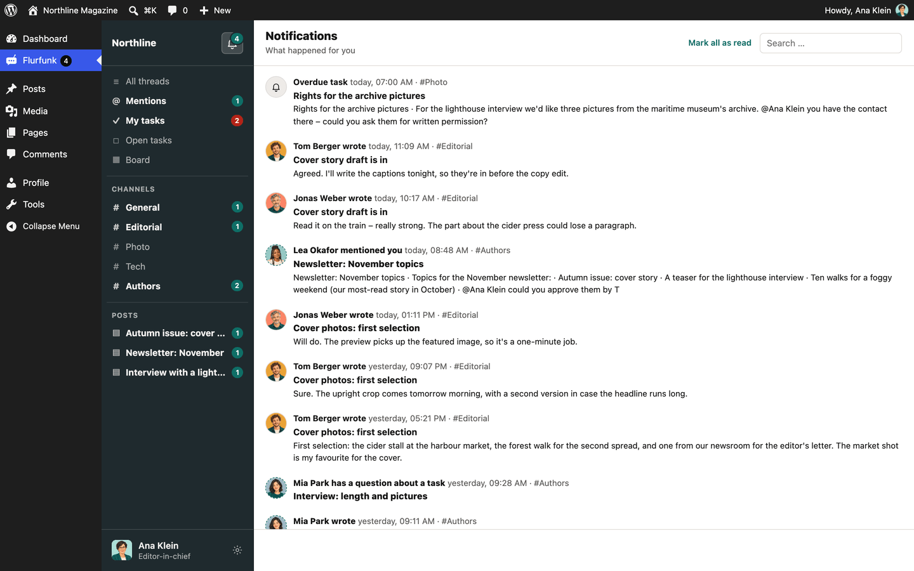

### Per channel

The header of each channel has a "Notify" menu:

| Choice | Effect |
| --- | --- |
| as usual | Your general mail and push settings apply. |
| every new post | Every new thread and reply in this channel notifies you. |
| only mentions | Only what concerns you personally (mentions, tasks, replies in your threads). |

## Your settings

Click your name at the bottom of the sidebar.

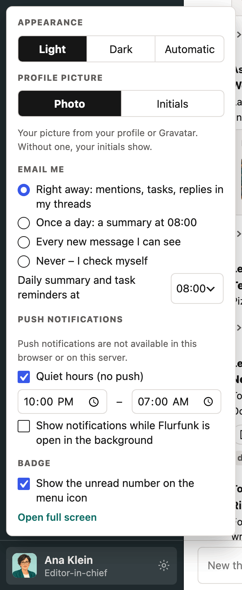

| Setting | Choices |
| --- | --- |
| Appearance | Light, dark, or automatic (follows your system) |
| Profile picture | Photo (your WordPress profile picture or Gravatar) or initials |
| Email me | **Right away**: mentions, tasks, replies and the other personal kinds above. **Once a day**: one summary of your unread notifications. **Every new message I can see.** **Never.** |
| Daily summary and task reminders at | The hour (site time zone) for the daily summary and due reminders. Default 7:00. |
| Push notifications | On or off for this device, then what to push: mentions/tasks/replies, everything, or nothing. **Send a test** checks that it works. |
| Pause | Stops push for 1 hour, 3 hours or until tomorrow. Your name tile shows until when; **Resume** ends it early. |
| Quiet hours | A time window (site time zone) without push, for example 22:00 to 07:00. |
| Show notifications while Flurfunk is open in the background | System notifications from the open tab, without push. |
| Badge | Show the unread number on the menu item and in the tab title. |

### Push on phones and tablets

Push works in current desktop and Android browsers once you turn it on. On iPhone and iPad it
only works when Flurfunk is installed as a web app:

1. Open Flurfunk in Safari.
2. Tap *Share → Add to Home Screen*.
3. Open Flurfunk from the home screen and log in.
4. Open your settings and turn push on.

Push is set per device. Turn it on in each browser and on each phone you use.

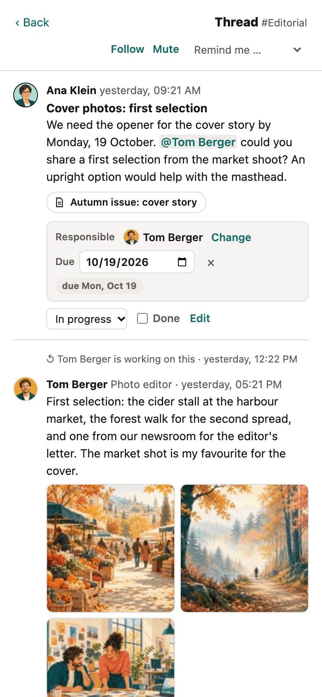

### Dark appearance

With **Dark** (or **Automatic** while your system is dark) the whole app switches colours; the
sidebar keeps your site's colour.

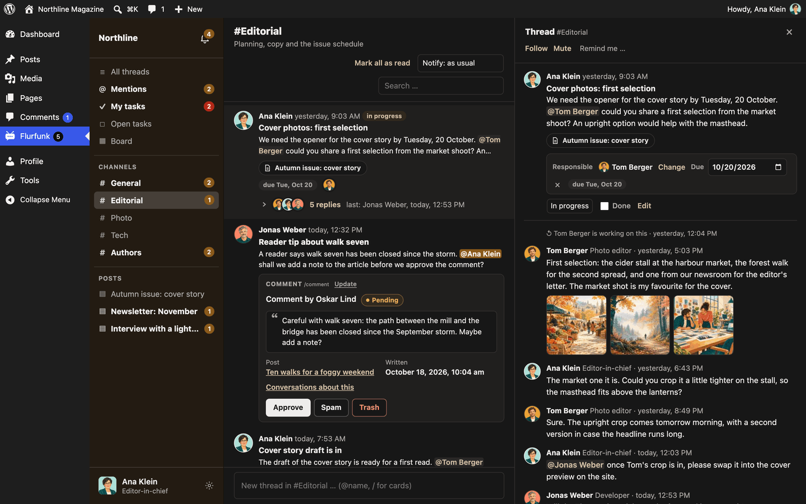

## Keyboard shortcuts

| Keys | Where | Does |
| --- | --- | --- |
| Ctrl+K / Cmd+K | Overview | Jump to the search box |
| Enter | Message and reply boxes | Send, or save an edit (on phones and tablets: a new line; use the button) |
| Shift+Enter | Message and reply boxes | New line (inside a code block started with three backticks, Enter makes one too) |
| Ctrl+Enter / Cmd+Enter | Message and reply boxes | Send, also on a tablet with a keyboard |
| Escape | Mention or command menu | Close the menu |
| Escape | Editing a message | Cancel the edit |
| Escape | Your settings | Close them |
| Escape | Open thread (focus outside the text boxes) | Close the thread |
| Escape | Lightbox | Close it |
| Arrow left / right | Lightbox | Previous or next image |
| Arrow down / up | Text box with an open menu, pickers | Move through the suggestions |
| Enter or Tab | Text box with an open mention or command menu | Take the first suggestion |
| Enter | Search box of the "Attached to" picker | Choose the first result |
| Enter or Space | Focused thread in the list or card on the board | Open it |
| Alt+Arrow left / right | Focused card on the board | Move it to the previous or next column |
| Arrow left / right | Focused column edge | Make the column narrower or wider |

## For guests

If you are a guest (for example a guest author), you see the channels the site opened to
guests. In most setups that means the threads about your own posts. You can:

- start conversations about your own posts
- reply, mention people, attach files (if you may upload), tick tasks
- see the posts with conversations under **My posts** in the sidebar

Internal team threads stay invisible to you unless a channel is open to guests.
